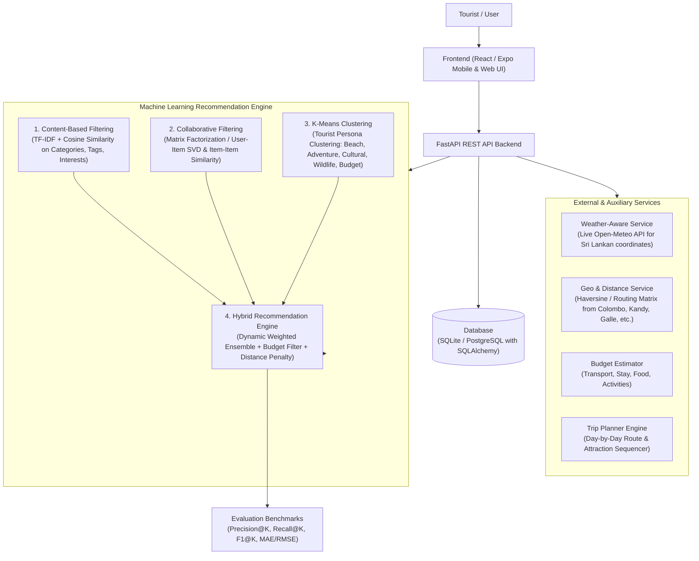

# Implementation Plan: ML-Based Personalized Sri Lanka Tourism Recommendation & Trip Planning System

This plan outlines the end-to-end architecture, implementation steps, dataset design, machine learning algorithms, backend APIs, and frontend application specified in the project proposal for **"An ML-Based Personalized Tourism Recommendation and Trip Planning System for Sri Lanka"**.

---

## System Overview & Architecture



---

## User Review Required

> [!IMPORTANT]
> **Frontend Implementation Preference:**
> The proposal specifies `React Native + Expo`. In development environments on Windows without Android Studio/Xcode pre-configured, running Expo for Web or a responsive Vite+React UI styled with a mobile app shell gives an immediate, interactive live preview in browser while supporting mobile screen dimensions. We can set up **Expo** (with web preview enabled) or a **Responsive Modern React Web App** that mimics the mobile experience with live map and touch interactions.
> Please indicate if you prefer:
> 1. **Expo (React Native Web + Mobile)**: Standard Expo app that runs locally in browser and Expo Go mobile.
> 2. **Vite + React (Interactive Mobile-first Web App)**: Extremely fast local dev server, instant hot reload, rich UI components and Leaflet map integration.

> [!NOTE]
> **Database:**
> We will configure SQLAlchemy with dual support: **SQLite** out-of-the-box (zero configuration, instant setup) with an environment switch to **PostgreSQL** (via `DATABASE_URL` in `.env`) exactly matching the proposal.

---

## Proposed Implementation Phases

### Phase 1: Sri Lankan Tourism Dataset & Synthetic User Interactions
Create a curated, comprehensive dataset covering top tourist destinations across all 9 provinces in Sri Lanka:
- **Destinations (`destinations.csv` & database seed):**
  - Name, Province, District, Latitude, Longitude
  - Category (Beaches, Nature/Hiking, Heritage/Cultural, Wildlife/Safari, Waterfalls, Adventure, Wellness/Ayurveda)
  - Activity tags (Surfing, Snorkeling, Trekking, Wildlife Safari, Temple Visits, Tea Factory Tours, Whale Watching, Train Rides)
  - Estimated cost per day (LKR: Budget, Mid-range, Luxury)
  - Recommended stay duration (hours / days)
  - Best visiting months / seasons (e.g. Southwest Monsoon vs Northeast Monsoon suitability)
  - Family-friendliness score, adventure-level score, serenity score
  - High-resolution representative imagery, ratings, and descriptions
  - Major destinations: *Sigiriya, Ella, Nuwara Eliya, Galle Fort, Mirissa, Yala National Park, Kandy Temple of the Tooth, Knuckles Range, Kitulgala, Arugam Bay, Trincomalee, Anuradhapura, Polonnaruwa, Horton Plains, Adams Peak, Bentota, Sinharaja Forest, Dambulla, Jaffna, Tangalle, etc.*
- **User Interactions & Ratings Dataset (`ratings.csv`):**
  - Synthesized realistic interaction matrix (500+ users, 2,000+ ratings across tourist personas) for collaborative filtering training and evaluation.

### Phase 2: Machine Learning Recommendation Engine (`backend/ml/`)
Develop four modular ML algorithms using `scikit-learn`, `numpy`, and `pandas`:
1. **Content-Based Filtering (`content_based.py`):**
   - Feature engineering combining destination categories, activity tags, province, and tourist profile preferences.
   - TF-IDF Vectorizer and Cosine Similarity calculation.
2. **Collaborative Filtering (`collaborative.py`):**
   - Matrix Factorization / TruncatedSVD and Item-Based Collaborative Filtering on user-destination ratings matrix.
   - Solves cold-start fallback gracefully using content-based signals.
3. **K-Means Clustering (`clustering.py`):**
   - Tourist segmentation into archetypes:
     - *Persona 0: Sun, Sand & Ocean (Mirissa, Bentota, Arugam Bay)*
     - *Persona 1: Adventure & Extreme Nature (Kitulgala, Knuckles, Ella Rock)*
     - *Persona 2: Culture, History & Spirituality (Kandy, Sigiriya, Anuradhapura)*
     - *Persona 3: Wildlife & Biodiversity (Yala, Wilpattu, Sinharaja, Udawalawe)*
     - *Persona 4: Hill Country & Tea Trails (Nuwara Eliya, Horton Plains, Haputale)*
   - Assigns user to nearest cluster to boost relevant destination weights.
4. **Hybrid Recommendation Engine (`hybrid.py`):**
   - Combines normalized scores:
     $$\text{Final Score} = w_1 \cdot S_{\text{content}} + w_2 \cdot S_{\text{collab}} + w_3 \cdot S_{\text{cluster}} - \text{Penalty}_{\text{budget}} - \text{Penalty}_{\text{distance}} + \text{Bonus}_{\text{weather}}$$
   - Applies strict filters for user budget cap and max travel radius.
5. **Model Evaluation & Benchmarking (`evaluate.py`):**
   - Computes **Precision@K**, **Recall@K**, **F1-Score**, and **MAE / RMSE**.
   - Generates a comparison report between Content-Based, Collaborative, and Hybrid models.

### Phase 3: Trip Planning, Budget Estimation & Weather Integration
1. **Trip Planning Module (`services/itinerary.py`):**
   - Generates day-by-day itineraries (1 to 7+ days) given:
     - Starting city (Colombo, Kandy, Galle, Katunayake Airport, etc.)
     - Duration (number of days)
     - Budget (Total LKR)
     - Travel interests
   - Clusters destinations by geographic proximity to minimize transit time, sequencing visits with optimal morning/afternoon schedules.
2. **Budget Estimation Module (`services/budget.py`):**
   - Calculates itemized breakdown:
     - Transport (Public train/bus vs Private AC vehicle vs Tuk-tuk)
     - Accommodation (Hostel/Guesthouse vs 3-Star vs Boutique/Resort)
     - Food & Dining (Local eateries vs Mid-range restaurants)
     - Activity entry tickets (e.g., Sigiriya foreign/local tickets, Yala safari jeep + permit)
3. **Weather-Aware Service (`services/weather.py`):**
   - Integrates live open weather API (Open-Meteo, free, no API key required) for Sri Lankan geographic coordinates.
   - Checks rain probability and monsoon alerts, adjusting scores or suggesting indoor/alternative attractions if severe weather is predicted.

### Phase 4: FastAPI Backend Architecture (`backend/`)
- Directory layout:
  ```
  backend/
  ├── app/
  │   ├── api/
  │   │   ├── auth.py            # User registration, login, JWT tokens
  │   │   ├── destinations.py    # CRUD, search, filter, categories
  │   │   ├── recommendations.py # ML recommendation endpoints
  │   │   ├── trips.py           # Trip generation, saving, sharing
  │   │   ├── reviews.py         # Reviews, ratings, favorites
  │   │   ├── admin.py           # Admin stats, destination management
  │   │   └── weather.py         # Live weather forecast proxy
  │   ├── core/
  │   │   ├── config.py          # Settings, env vars, database connection
  │   │   └── security.py        # Password hashing & JWT logic
  │   ├── db/
  │   │   ├── database.py        # SQLAlchemy engine & session maker
  │   │   └── seed.py            # Dataset loader & DB seeder
  │   ├── ml/
  │   │   ├── content_based.py
  │   │   ├── collaborative.py
  │   │   ├── clustering.py
  │   │   ├── hybrid.py
  │   │   └── evaluate.py
  │   ├── models/                # SQLAlchemy DB models (User, Destination, Review, Trip, etc.)
  │   ├── schemas/               # Pydantic schemas for request/response validation
  │   ├── services/
  │   │   ├── budget.py
  │   │   ├── itinerary.py
  │   │   └── weather.py
  │   └── main.py                # FastAPI app entry point with CORS
  ├── data/
  │   ├── destinations.csv       # Curated Sri Lanka destinations
  │   └── user_ratings.csv       # Synthetic interaction matrix
  ├── requirements.txt
  └── run.py
  ```

### Phase 5: Client Application (UI/UX)
- Modern travel application interface designed with Sri Lanka aesthetics (emerald green, tropical hues, ocean blues, card elevation, clean glassmorphism):
  - **Onboarding & Interest Selector**: Interactive tags (Beaches, Wildlife, Tea Plantations, Surfing, Hiking, Heritage).
  - **Trip Planner Wizard**: Starting city, travel dates, budget slider (LKR / USD), party size (solo, couple, family, friends).
  - **Recommendation Feed**: Ranked destination cards with match score badge (e.g. `96% Match - Nature & Adventure`), photos, estimated cost, and current weather badge.
  - **Destination Details**: Map view, photo gallery, best time to visit, activity tags, user reviews, weather forecast.
  - **Interactive Itinerary View**: Day-by-day interactive timeline with map route, travel times, and itemized budget breakdown.
  - **Admin Dashboard**: Statistics on destination popularity, model evaluation metrics display, destination CRUD interface.

---

## Verification Plan

### Automated Tests
- `uv run pytest backend/tests/test_ml.py` — Test Content-Based, Collaborative, K-Means, and Hybrid recommendation outputs.
- `uv run pytest backend/tests/test_api.py` — Test FastAPI endpoints (Auth, Destinations, Recommendations, Trips, Budget).
- Run evaluation script `python backend/app/ml/evaluate.py` to output Precision@K, Recall@K, and RMSE benchmark tables.

### Manual Verification
- Test user flow: Register $\to$ Set interests (e.g., Adventure + Nature, 3 days, 40,000 LKR budget, starting Colombo) $\to$ Verify returned destinations match Ella, Kitulgala, Nuwara Eliya $\to$ Generate 3-day itinerary $\to$ Verify budget breakdown and weather forecast.
- Verify Admin dashboard and interactive map markers.
